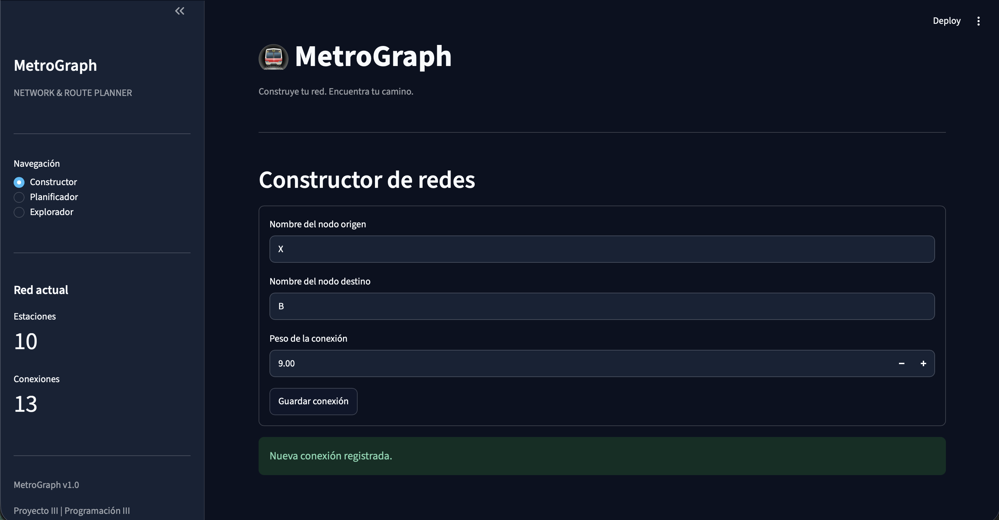
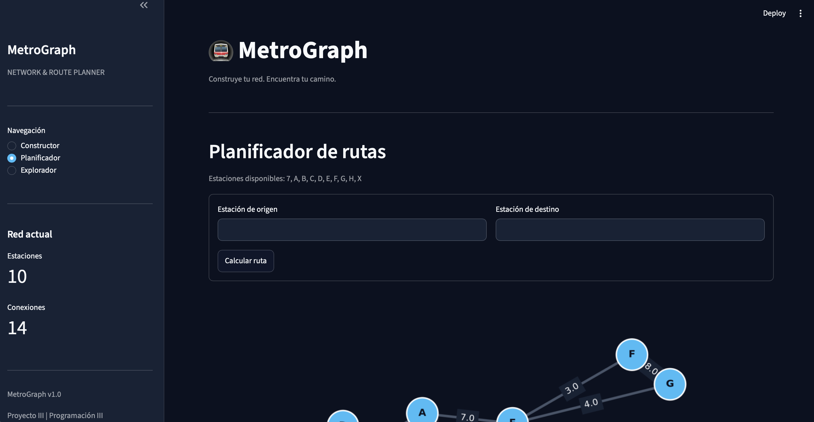
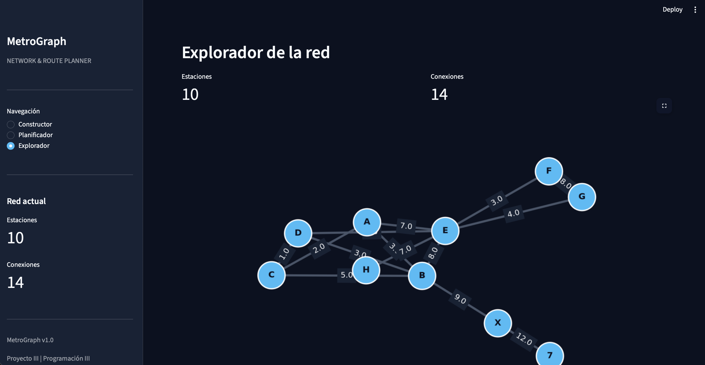

# 🚇 MetroGraph

### Construye tu red. Encuentra tu camino.


## Descripción

MetroGraph es una aplicación web interactiva desarrollada en Python y Streamlit que permite construir, visualizar y optimizar redes de transporte personalizadas mediante la teoría de grafos y el algoritmo de Dijkstra.

El proyecto surge de la evolución de las actividades realizadas durante la asignatura de Programación III, integrando estructuras de datos, persistencia de información, manejo de excepciones, programación modular y desarrollo de interfaces gráficas.

## Funcionalidades

### Constructor
- Creación de estaciones y conexiones.
- Asignación y actualización de pesos.
- Validación de los datos ingresados.
- Almacenamiento persistente mediante CSV.
- Prevención de conexiones duplicadas.

### Planificador
- Cálculo de rutas óptimas mediante Dijkstra.
- Visualización del costo mínimo.
- Presentación de la secuencia del recorrido.
- Resaltado gráfico de la ruta óptima.

### Explorador
- Visualización gráfica de la red.
- Catálogo de conexiones mediante Pandas.
- Indicadores de estaciones y conexiones registradas.

## Tecnologías utilizadas

| Tecnología | Propósito |
|---|---|
| Python | Lenguaje principal |
| Streamlit | Interfaz gráfica web |
| Pandas | Presentación tabular de datos |
| NetworkX | Representación gráfica de la red |
| Matplotlib | Visualización y personalización del grafo |
| CSV | Persistencia de información |
| Flake8 | Análisis estático y calidad de código |
| Git y GitHub | Control de versiones |

## Arquitectura

El proyecto mantiene una arquitectura modular que separa la interfaz gráfica, la lógica de negocio y la persistencia de información.

- `app.py`: interfaz gráfica desarrollada con Streamlit.
- `grafo.py`: clases Nodo y Grafo e implementación de Dijkstra.
- `io_handler.py`: validación, lectura y escritura de conexiones.
- `main.py`: interfaz original de consola.
- `nodos.csv`: almacenamiento persistente.
- `.streamlit/config.toml`: configuración del tema visual.
- `requirements.txt`: dependencias.
- `.gitignore`: exclusión de archivos innecesarios.
- `README.md`: documentación.

## Instalación

Se requiere Python 3.10 o superior.

Desde la carpeta del proyecto, crear un entorno virtual:

```bash
python3 -m venv .venv
```

Activar el entorno virtual en macOS o Linux:

```bash
source .venv/bin/activate
```

En Windows:

```bash
.venv\Scripts\activate
```

Instalar las dependencias:

```bash
python -m pip install -r requirements.txt
```

## Ejecución

Para iniciar la interfaz web:

```bash
python -m streamlit run app.py
```

Para utilizar la versión original de consola:

```bash
python main.py
```

## Gestión del estado

MetroGraph utiliza `st.session_state` para almacenar el objeto Grafo en memoria RAM durante la sesión del usuario.

La carga inicial del archivo CSV se realiza una sola vez en una sesión iniciada correctamente. Las nuevas conexiones se guardan en disco y se actualizan directamente en el grafo en memoria, evitando lecturas redundantes.

## Persistencia de datos

Las conexiones se almacenan en el archivo `nodos.csv` utilizando la siguiente estructura:

```csv
Origen,Destino,Peso
A,B,4
A,C,2
B,D,3
C,D,1
```

La red es bidireccional y admite pesos numéricos finitos no negativos. Cuando una conexión ya existe, su peso se actualiza sin generar un registro duplicado.

## Manejo de excepciones

La aplicación incorpora excepciones específicas para gestionar entradas inválidas, estaciones inexistentes y errores relacionados con la lectura y escritura de archivos.

Las notificaciones se presentan mediante alertas visuales en Streamlit.

## Calidad de código

El proyecto incorpora buenas prácticas de ingeniería de software:

- Programación orientada a objetos.
- Arquitectura modular.
- Type hints y docstrings.
- Manejo de excepciones específicas.
- Estándar de estilo PEP 8.
- Control de versiones mediante ramas.

Para verificar la calidad del código:

```bash
python -m flake8 .
```

## Alcance actual

MetroGraph 1.0 está diseñado para administrar una sola red editable en un entorno de uso individual. No contempla todavía la edición concurrente por múltiples usuarios.

## Mejoras futuras

- Nodos interactivos y arrastrables.
- Eliminación de estaciones y conexiones.
- Administración de múltiples redes.
- Importación y exportación de redes.
- Migración hacia una arquitectura web más amplia.

## Autor

Emiliano Villalobos Luevano

Licenciatura en Inteligencia Artificial y Análisis de Datos.

Programación III — Proyecto 3.

2026.







