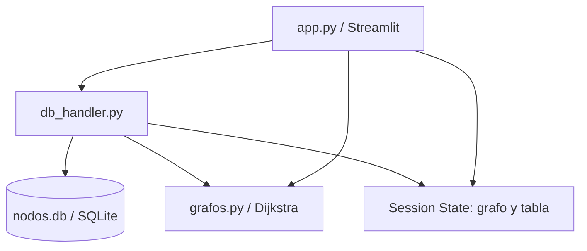
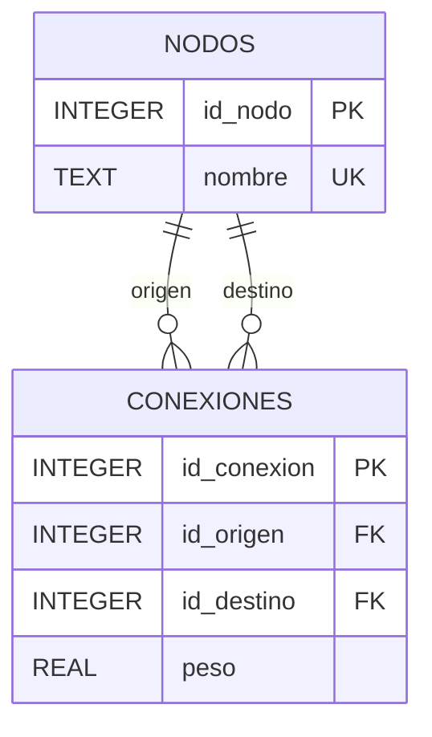
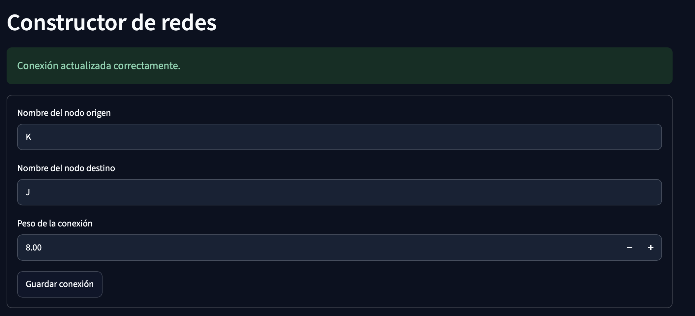
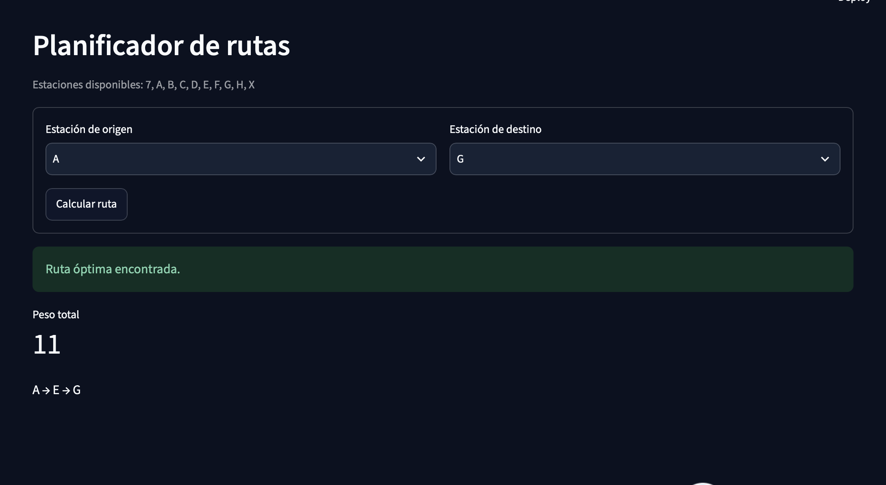
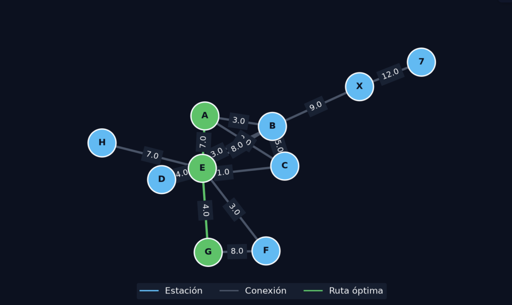
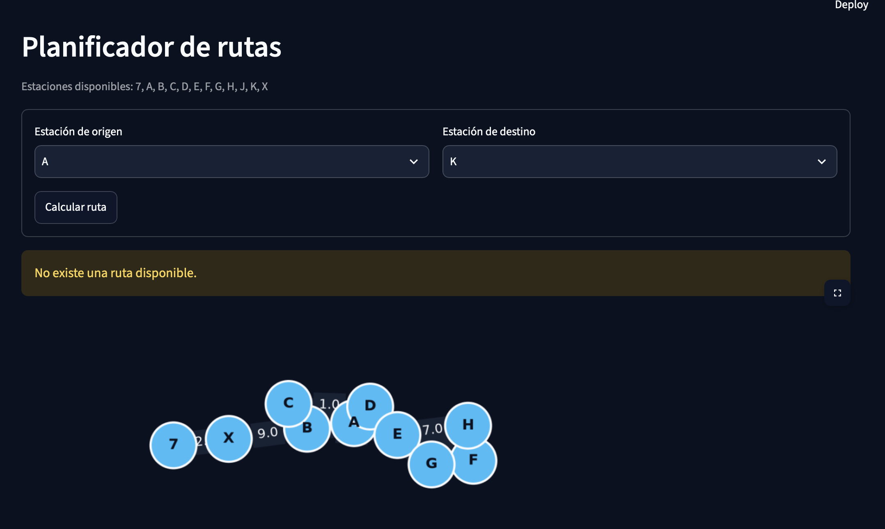
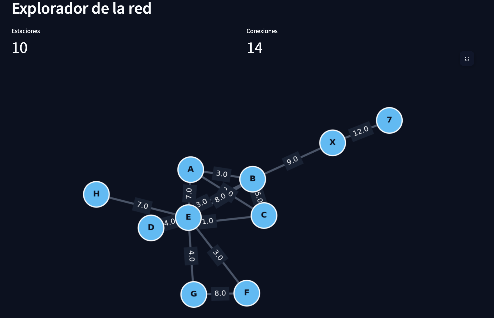
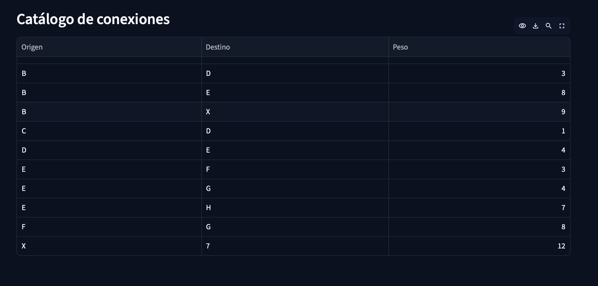
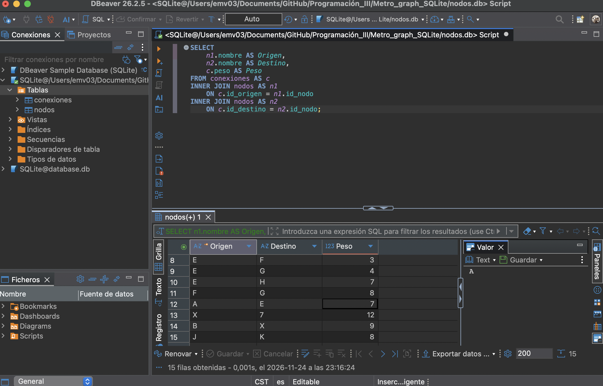

# 🚇 MetroGraph 2.0

### Construye tu red. Encuentra tu camino.


## Descripción

MetroGraph es una aplicación web interactiva desarrollada en Python y Streamlit que permite construir, visualizar y optimizar redes de transporte personalizadas mediante la teoría de grafos y el algoritmo de Dijkstra.

El proyecto surge de las actividades de Programación III. En esta versión sustituimos el almacenamiento mediante CSV por una base de datos relacional SQLite, conservando la interfaz y el algoritmo desarrollados anteriormente.

## Evolución del proyecto

- Implementación de nodos, grafos ponderados y Dijkstra.
- Persistencia mediante CSV, validaciones y actualización de conexiones.
- Desarrollo de la interfaz web MetroGraph 1.0 con Streamlit.
- Migración a SQLite, normalización, consultas JOIN y sincronización de la red en memoria.

## Funcionalidades

### Constructor

- Registro de estaciones y conexiones bidireccionales con pesos positivos y finitos.
- Actualización del peso de conexiones existentes sin duplicarlas.
- Validación de nombres y prevención de autoconexiones.
- Almacenamiento permanente en SQLite.

### Planificador

- Selección dinámica de estaciones mediante listas desplegables.
- Cálculo de rutas óptimas mediante una implementación propia de Dijkstra.
- Visualización del costo mínimo y del recorrido resaltado en verde.
- Aviso cuando no existe una ruta entre dos estaciones.

### Explorador

- Visualización gráfica de la red y catálogo de conexiones recuperado mediante JOIN.
- Indicadores de estaciones y conexiones registradas.

## Arquitectura

| Componente | Responsabilidad |
|---|---|
| `app.py` | Interfaz, formularios, mensajes y visualización. |
| `grafos.py` | Clases Nodo y Grafo; algoritmo de Dijkstra. |
| `db_handler.py` | Validaciones de persistencia, consultas SQLite, transacciones y creación del DataFrame. |
| `nodos.db` | Base de datos relacional con registros de prueba. |



## Modelo relacional



Los nombres de estaciones se almacenan una sola vez. Las conexiones hacen referencia a sus identificadores mediante llaves foráneas. Se aplican restricciones NOT NULL, UNIQUE y CHECK. Los identificadores se ordenan para representar cada conexión bidireccional una sola vez; UPSERT permite actualizar su peso sin duplicar registros. Las llaves foráneas se activan en cada conexión de Python.

La siguiente consulta recupera los nombres de ambos extremos:

```sql
SELECT n1.nombre AS Origen, n2.nombre AS Destino, c.peso AS Peso
FROM conexiones AS c
INNER JOIN nodos AS n1 ON c.id_origen = n1.id_nodo
INNER JOIN nodos AS n2 ON c.id_destino = n2.id_nodo
ORDER BY n1.nombre, n2.nombre;
```

## Tecnologías utilizadas

| Tecnología | Versión del entorno | Propósito |
|---|---|---|
| Python | 3.12.9 | Lenguaje principal |
| SQLite | 3.45.3 | Persistencia relacional mediante sqlite3 |
| Streamlit | 1.67.0 | Interfaz web |
| Pandas | 3.1.1 | Representación tabular |
| NetworkX | 3.7 | Representación gráfica de la red |
| Matplotlib | 3.11.2 | Visualización del grafo |
| Flake8 | 7.5.0 | Análisis estático y estilo |
| DBeaver | — | Inspección de la base de datos |
| Git y GitHub | — | Control de versiones |

## Instalación y ejecución

Desde la carpeta que contiene `app.py`, utilizar Python 3.12.9 y crear un entorno virtual:

```bash
python3 -m venv .venv
source .venv/bin/activate
```

En Windows PowerShell, activar con `.venv\Scripts\Activate.ps1` en lugar del segundo comando.

```bash
python -m pip install -r requirements.txt
streamlit run app.py
```

Abrir la dirección local que indique Streamlit. No se necesita un servidor de base de datos externo. SQLite forma parte de la biblioteca estándar de Python.

## Gestión del estado

La aplicación recupera el grafo y la tabla desde SQLite al iniciar la sesión y los conserva en `st.session_state`. Después de guardar una conexión, vuelve a cargar la red y actualiza la interfaz. Los cambios de sección y los cálculos de rutas reutilizan los datos en memoria sin consultar SQLite en cada interacción.

## Inspección mediante DBeaver

1. Crear una conexión de tipo SQLite y seleccionar el archivo `nodos.db` del proyecto.
2. Abrir las tablas `nodos` y `conexiones` para consultar registros, restricciones y llaves foráneas.
3. Ejecutar la consulta JOIN anterior desde el editor SQL.
4. Ejecutar `PRAGMA integrity_check;` (resultado esperado: `ok`) y `PRAGMA foreign_key_check;` (sin filas).

## Pruebas y evidencias

La base entregada contiene 12 estaciones y 15 conexiones. Las capturas muestran diferentes momentos de las pruebas, por lo que los conteos iniciales pueden ser menores.

| Prueba | Resultado |
|---|---|
| Ruta A–G | A → E → G; peso 11 |
| Ruta J–K | Peso 8 |
| Ruta A–K | No existe ruta |
| Actualización de conexión inversa | Sin duplicados |
| Nombres vacíos, autoconexión y peso no positivo | Rechazados |
| Integridad de SQLite | ok; sin violaciones de llaves foráneas |

### Constructor




### Planificador







### Explorador





### DBeaver



## Buenas prácticas y calidad de código

Se utiliza programación orientada a objetos, modularización, type hints, docstrings, consultas parametrizadas y manejo de excepciones específicas. Los bloques try cuentan con al menos dos except. Los errores de persistencia se traducen a excepciones propias y la interfaz informa mediante alertas de Streamlit.

```bash
python -m flake8 app.py db_handler.py grafos.py
```

## Alcance actual y mejoras futuras

MetroGraph administra una sola red editable de uso individual. No contempla sincronización en tiempo real entre usuarios, eliminación de estaciones o conexiones ni mapas geográficos reales. Como mejoras futuras se propone incorporar edición visual de nodos, administración de múltiples redes e importación y exportación de datos.

## Conclusión personal

A lo largo de Programación III pude comprender de mejor manera cómo se desarrolla un proyecto de software y cómo puede evolucionar conforme se adquieren nuevos conocimientos. Comenzamos con estructuras de datos y algoritmos, incorporamos archivos CSV, desarrollamos una interfaz gráfica y finalmente implementamos una base de datos relacional.

Uno de los aprendizajes más importantes fue entender que programar no consiste únicamente en conseguir que un código funcione, sino también en procurar que sea entendible, organizado y fácil de mantener. El uso de módulos, manejo de excepciones, validaciones y Flake8 me permitió identificar la importancia de las buenas prácticas.

Lo que más me gustó fue trabajar sobre un mismo proyecto durante diferentes etapas y observar cómo una idea sencilla se convirtió en una aplicación más completa. También me pareció interesante utilizar GitHub. Lo que menos disfruté fue enfrentar algunos errores al integrar los componentes, aunque esos problemas me ayudaron a comprender mejor el código. Como mejora de la materia, propondría dedicar más tiempo a la integración y a ejercicios de depuración.

Finalmente, MetroGraph representa buena parte de los conocimientos adquiridos durante el semestre. Me quedo con una mejor comprensión de Python, las estructuras de datos, las bases de datos y la manera en que estos conocimientos pueden combinarse para desarrollar una aplicación funcional.

## Autor

Emiliano Villalobos Luevano

Licenciatura en Inteligencia Artificial y Análisis de Datos.

Programación III — Proyecto 4 · 2026.
